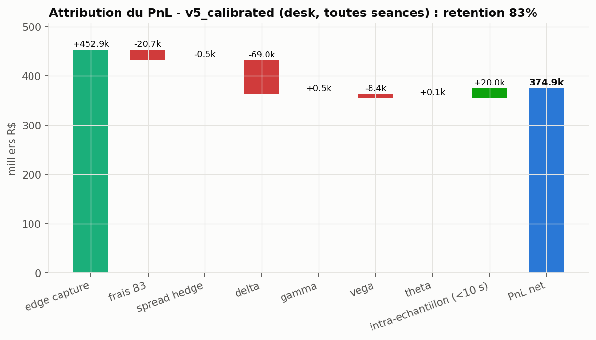
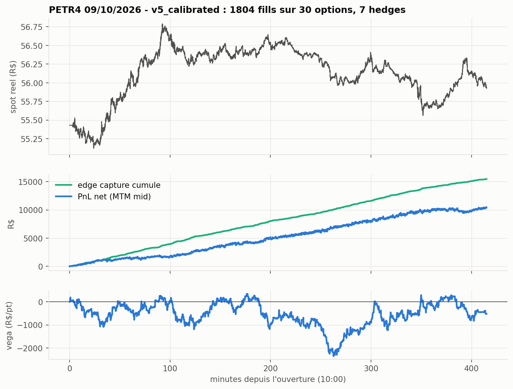
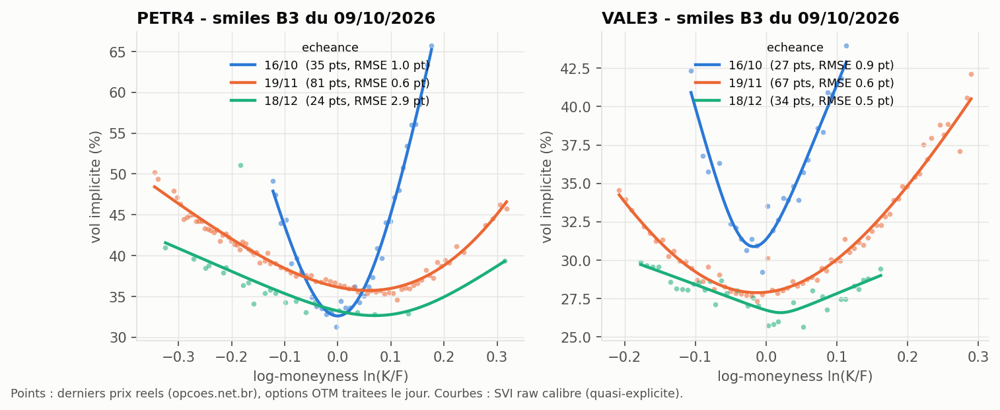
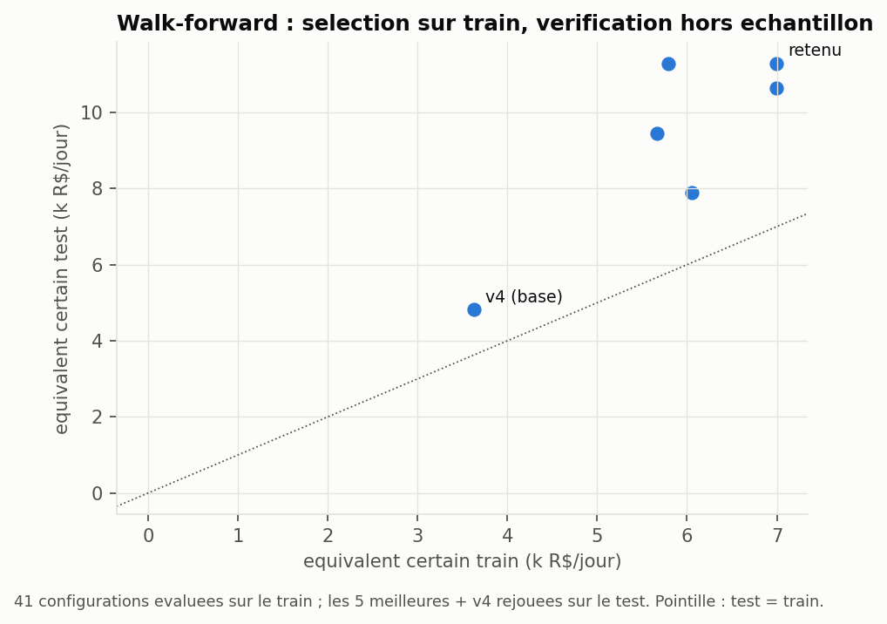

# B3 Options AMM — Market-making haute frequence sur options actions bresiliennes

Strategie automatisee de tenue de marche (AMM) sur les options actions de la **B3**
(PETR4, VALE3), de la premiere version naive jusqu'a un modele calibre qui genere du PnL,
avec la boucle complete **KPI -> diagnostic -> iteration du modele -> parametrisation**.

> **Ce qui est reel, ce qui est simule.** Le spot (barres 1 minute Yahoo Finance, 20 seances),
> la chaine d'options B3 (strikes, derniers prix, nombre de trades, volumes, via opcoes.net.br),
> la Selic (BCB) et le calendrier B3 sont **reels**. Le carnet d'ordres tick-by-tick des options
> n'est pas public : le **flux d'ordres et les quotes concurrents sont simules**, mais calibres sur
> les donnees reelles (intensites = GLM de Poisson sur les trades reels, nappe = SVI sur les prix
> reels, spot = pont brownien sur les vraies barres). Les PnL ci-dessous sont donc ceux d'un
> **backtest en environnement simule** : ils servent a comparer les versions du modele entre elles
> (meme marche, memes ordres), pas a promettre un PnL de production.

---

## Resultats — iteration du modele (hors echantillon)

10 seances de test (28/09 -> 09/10/2026), jamais vues pendant la calibration, desk = PETR4 + VALE3.
Chaque version voit **exactement le meme marche et les memes ordres candidats** (common random numbers).

| Version | Brique ajoutee | PnL net (R$) | PnL / jour | Retention | Sharpe ann. | Edge / contrat | Markout 60 s / contrat |
|---|---|---:|---:|---:|---:|---:|---:|
| v0_naive | theo +/- demi-spread ecran, hedge lent | 35 192 | 3 519 | 68 % | 16.4 | 1.51 | 1.03 |
| v1_glft | spread optimal GLFT + skew par option | 91 818 | 9 182 | 66 % | 45.8 | 1.26 | 0.88 |
| v2_factor | skew dans l'espace facteurs (vol ATM + spot) | 101 076 | 10 108 | 68 % | 38.8 | 1.27 | 0.93 |
| v3_queue | placement conscient de la file | 101 868 | 10 187 | 68 % | 39.6 | 1.28 | 0.94 |
| v4_fade | fade sur le flux (options -> spot) | 111 090 | 11 109 | 74 % | 35.6 | 1.24 | 1.00 |
| **v5_calibrated** | **parametres calibres en walk-forward** | **218 771** | **21 877** | **77 %** | **45.8** | 0.84 | 0.69 |

Sur les 20 seances : v0 53.7 k R$ -> v5 374.9 k R$, retention 67 % -> 83 %.

**Decomposition honnete du gain v4 -> v5** (+10.8 k R$/jour hors echantillon) :
la calibration a double le clip (10 -> 20 contrats). A clip egal, v4 fait 16.6 k R$/jour :
**~5.5 k viennent de la taille, ~5.3 k du reste de la calibration** (kappa, fade, poids du risque spot),
avec une volatilite quotidienne plus faible (7.6 k vs 7.9 k). L'edge par contrat baisse (1.24 -> 0.84) :
le modele cote plus serre et plus gros, et gagne sur le volume.

<table>
<tr>
<td width="50%"><p align="center"><sub>PnL cumule du desk par version</sub></p></td>
<td width="50%"><p align="center"><sub>Markouts : brut vs delta-couvert</sub></p></td>
</tr>
<tr>
<td width="50%"><p align="center"><sub>Attribution du PnL de v5</sub></p></td>
<td width="50%"><p align="center"><sub>Une seance PETR4 : spot reel, PnL vs edge, inventaire vega</sub></p></td>
</tr>
<tr>
<td width="50%"><p align="center"><sub>Smiles B3 reels vs SVI calibre</sub></p></td>
<td width="50%"><p align="center"><sub>Walk-forward : train vs test</sub></p></td>
</tr>
</table>

---

## La boucle KPI -> iteration (ce que les donnees ont appris au modele)

1. **v1 : la fuite est directionnelle.** L'attribution greeks montre que l'edge capture est rogne
   surtout par le **PnL delta** (-41.7 k R$ hors echantillon pour v1), pas par la vega. Les markouts le
   confirment : le markout **brut** decroit de 1.26 a 0.88 R$/contrat entre le fill et 60 s, alors que
   le markout **delta-couvert** reste plat. Le flux options est informe sur le **sous-jacent**.
2. **v2 : un skew vega seul aggrave le delta.** Une premiere version du skew factoriel (vega ATM seule)
   construisait des risk-reversals vega-neutres mais tres directionnels : PnL delta en hausse. Correction :
   le spot devient un **second facteur** de la covariance GLFT, pondere par la part du delta laissee
   ouverte par la bande de hedge. Le skew porte alors sur la vol ET le spot.
3. **v3 : neutre, et documente comme tel.** Plafonner l'amelioration de l'ecran a 1 tick ne change
   presque rien (+0.8 %) : les ecrans PETR4/VALE3 sont deja a 2-3 ticks, la contrainte mord rarement.
4. **v4 : le fade sur flux recupere l'adverse selection.** Chaque fill deplace le spot de reference
   dans le sens de l'agresseur (demi-vie 20 s) : PnL delta -43.4 k -> -35.1 k, retention 68 % -> 74 %.
5. **Elargissement sur markout : rejete par les donnees.** L'elargissement adaptatif (cout d'adverse
   selection = decay delta-couvert de l'edge) est dans l'espace de recherche ; la calibration le met a 0.
   Coherent avec le diagnostic : la toxicite est directionnelle, elle se gere par le skew spot et le fade,
   pas en elargissant (ce qui couterait du volume).
6. **v5 : parametrisation.** Recherche aleatoire de 40 configurations sur 10 seances de train, selection
   par equivalent certain (moyenne - ecart-type du PnL flat EOD quotidien), puis verification sur les
   10 seances de test.

---

## Le modele

### Fair value et surface
- **Nappe** : SVI raw par echeance, calibration quasi-explicite (De Marco-Martini) + Nelder-Mead,
  ponderee par sqrt(nb de trades). Controle sans arbitrage papillon (g(k) >= 0, Gatheral-Jacquier).
- **Dynamique** : smile en moneyness standardisee z = ln(K/F)/(sigma_ATM sqrt T) (sticky-delta),
  niveau ATM interpole en variance totale, rescale chaque seance par RV20(jour)/RV20(snapshot) sans look-ahead.
- **Fit a l'ecran** toutes les 5 s : residus (mid - theo)/vega projetes sur le facteur ATM
  (moindres carres ponderes par (vega/demi-spread)^2), residus idiosyncratiques par EWMA.
- **Theo HFT** : entre deux reprices, developpement delta-gamma sur le spot (pas de repricing complet
  par tick) + decalage de fade sur flux.

### Quoting : Factor-GLFT
Gueant-Lehalle-Fernandez-Tapia multi-actifs : avec une intensite de remplissage A exp(-k delta),
la fonction valeur quadratique -1/2 q' Gamma q donne Gamma solution de Riccati

```
Gamma D Gamma = (gamma / 2) Sigma,    D = diag(A_i k_i clip_i C_i)
=> Gamma = D^-1/2 (D^1/2 (gamma/2) Sigma D^1/2)^1/2 D^-1/2

Sigma = sigma_f^2 e e' + w_d sigma_S^2 d d' + diag(sigma_u^2 nu_i^2)
        e_i = vega_i * beta_i   (facteur vol ATM, beta_i = sqrt(T_ref / T_i))
        d_i = delta_i           (facteur spot residuel, w_d = part non couverte)

bid_i = theo_i - c1_i - clip Gamma_ii / 2 - (Gamma q)_i
ask_i = theo_i + c1_i + clip Gamma_ii / 2 - (Gamma q)_i,   c1_i = ln(1 + gamma clip / k_i) / (gamma clip)
```
En mono-actif, `riccati_gamma` redonne exactement la forme fermee GLFT 2013 (teste).
k_i = kappa / demi-spread ecran observe, A_i = intensite estimee sur les trades reels de la chaine.

Puis contraintes de marche : arrondi au tick defavorable au MM, post-only (jamais croiser l'ecran),
placement conscient de la file, limites d'inventaire (contrats par option, vega du book), kill-switch
sur perte intraday.

### Couverture et risque
- Delta du book couvert en actions (lot 100), bande fixe ou Whalley-Wilmott, retour au bord de bande.
- Frais B3 (emolumentos/registro ~3 bp du premium, 0.5 bp sur l'action), demi-spread action paye a chaque hedge.

### Simulateur de marche (calibre sur le reel)
- Spot a la seconde : pont brownien entre les vrais closes 1 minute, vol intra-minute = Parkinson de la barre.
- Vol vraie = smile SVI x niveau ATM (OU correle -0.6 aux chocs spot reels) + residus par option inconnus du MM.
- Ecran concurrent : fair + bruit AR(1) +/- demi-spread (0.12 pt de vol + 0.3 % du premium), arrondi au tick.
- Flux bruit : Poisson, intensite = GLM de Poisson sur les trades reels (|z|, z^2, log T, call/put),
  rescale par l'activite reelle du sous-jacent ce jour-la, sensible au prix offert.
- Flux informe : connait le fair a t + 60 s et ne traite que s'il a au moins 0.5 tick d'edge.
- Priorite prix-temps simplifiee : meilleur prix strict = rempli, egalite = part de file (35 %).

### KPI suivis (`amm/kpi.py`)
Edge capture, **PnL retention** (PnL net / edge), markouts bruts et delta-couverts a 1 s ... 5 min,
attribution delta / gamma / vega / theta, frais, couts de hedge, uptime deux-sens, temps au meilleur prix,
spread cote vs ecran, vega moyenne / max, drawdown intraday, Sharpe, hit ratio, PnL flat EOD.

---

## Reproduire

```bash
pip install numpy pandas matplotlib yfinance pytest
cd b3-options-amm

python scripts/01_fetch_data.py          # (optionnel) rafraichit les donnees reelles -> data/
python scripts/02_calibrate_surface.py   # SVI par echeance + controle d'arbitrage
python scripts/03_calibrate_params.py    # walk-forward, ~5 min sur 8 coeurs
python scripts/04_backtest_iterations.py # v0 -> v5 sur toutes les seances, ~1-2 min
python scripts/05_figures.py             # figures/
python -m pytest tests -q                # 27 tests
```
Le cache `data/` est versionne : tout tourne hors ligne (et en CI) sans appel reseau.
Les scripts 03 et 04 utilisent un pool de processus : lance-les au premier plan dans un terminal.

App interactive : `streamlit run app/streamlit_app.py` puis page **B3 Options AMM**
(choix du sous-jacent, de la seance, de la version et des parametres ; une seance tourne en ~2 s).

---

## Structure

```
b3-options-amm/
├── amm/
│   ├── conventions.py   calendrier B3 (feriados), base 252, Selic, tick, lot, frais
│   ├── data.py          Yahoo 1m/daily, chaine opcoes.net.br, Selic BCB, cache CSV, validation
│   ├── pricing.py       Black-Scholes vectorise, greeks, IV Newton + bissection (numpy pur)
│   ├── svi.py           SVI raw, calibration quasi-explicite, Nelder-Mead, densite papillon
│   ├── surface.py       points d'IV reels, nappe calibree, dynamique sticky-delta
│   ├── universe.py      GLM de Poisson de l'activite, selection du book d'options du jour
│   ├── market.py        simulateur a la seconde (spot, vol vraie, ecran, flux bruit/informe)
│   ├── setup_day.py     assemblage d'une seance depuis le cache
│   ├── glft.py          GLFT multi-actifs : c1, covariance factorielle, Riccati
│   ├── strategy.py      quoter Factor-GLFT : fit ecran, theo delta-gamma, skew, AS, fade
│   ├── hedger.py        couverture delta a bande (fixe / Whalley-Wilmott)
│   ├── engine.py        boucle evenementielle, matching, comptabilite, kill-switch
│   ├── kpi.py           markouts, attribution greeks, retention, agregats
│   ├── params.py        parametres immuables + versions v0 -> v4
│   ├── calibration.py   recherche aleatoire, score, persistance de v5
│   └── runner.py        execution parallele multi-seances / multi-configs
├── scripts/01-05_*.py   pipeline donnees -> surface -> calibration -> backtest -> figures
├── tests/               27 tests pytest (pricing, SVI, Riccati, calendrier, moteur, KPI)
├── data/                cache reel + resultats (CSV/JSON)
└── figures/             7 figures PNG
```

## Limites connues

- **Flux simule.** Sans carnet d'ordres options public, intensites, part de file, comportement des
  concurrents et de l'informe sont des hypotheses (calibrees, mais des hypotheses). Les niveaux de PnL et
  de Sharpe en dependent fortement ; les **ecarts entre versions** sont l'information robuste.
- **Un seul snapshot de chaine** (09/10/2026) : la forme du smile est supposee stable sur les 4 semaines,
  seul le niveau ATM est rescale par la vol realisee. L'echeance 18/12 de PETR4 est mal identifiee
  (24 points, RMSE 2.9 pts de vol).
- **Seances independantes** : pas de portage overnight. Le PnL MTM est la convention desk ; le PnL
  "flat EOD" (inventaire liquide a l'ecran en fin de seance) est la borne conservatrice, et c'est lui
  qui sert d'objectif de calibration.
- **Pas de latence modelisee** cote MM (reaction a la seconde), pas d'impact du hedge sur le spot,
  pas d'exercice anticipe (calls B3 sans dividende grace a l'ajuste des proventos ; puts europeens).
- 20 seances seulement (limite Yahoo du 1 minute a 30 jours) : la calibration a un fort risque de
  sur-apprentissage, d'ou le walk-forward ; le test reste court.

## References

- Gueant, O. (2017). Optimal market making. *Applied Mathematical Finance*, 24(2).
- Gueant, O., Lehalle, C.-A., Fernandez-Tapia, J. (2013). Dealing with the inventory risk. *Mathematics and Financial Economics*, 7(4).
- Baldacci, B., Bergault, P., Gueant, O. (2021). Algorithmic market making for options. *Quantitative Finance*, 21(1).
- Avellaneda, M., Stoikov, S. (2008). High-frequency trading in a limit order book. *Quantitative Finance*, 8(3).
- Gatheral, J., Jacquier, A. (2014). Arbitrage-free SVI volatility surfaces. *Quantitative Finance*, 14(1).
- De Marco, S., Martini, C. (2009). Quasi-explicit calibration of Gatheral's SVI model. Zeliade white paper.
- Whalley, A. E., Wilmott, P. (1997). An asymptotic analysis of an optimal hedging model for option pricing with transaction costs. *Mathematical Finance*, 7(3).
- Glosten, L., Milgrom, P. (1985). Bid, ask and transaction prices in a specialist market with heterogeneously informed traders. *JFE*, 14(1).
